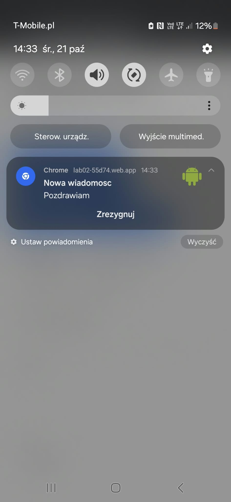

# Lab 02 – Powiadomienia i Web Push

## Co zostało zrealizowane

Aplikacja PWA z trzema rodzajami powiadomień: `new Notification(...)` ze strony, `registration.showNotification(...)` z service workera oraz Web Push wysyłany ze skryptu Node.js (`send-push.mjs`) z biblioteką `web-push` i kluczami VAPID. O zgodę na powiadomienia aplikacja pyta dopiero po kliknięciu przycisku, a aktualny stan uprawnienia (`default` / `granted` / `denied`) widać na stronie. Formularz (tytuł, treść, wybór ikony z trzech obrazków) wyświetla powiadomienie przez service workera, więc działa także na Androidzie; pusty tytuł jest odrzucany z komunikatem. Kliknięcie w powiadomienie przywołuje otwarte okno aplikacji albo otwiera nowe. Subskrypcję push można utworzyć, skopiować i anulować z poziomu strony, a powiadomienie dociera również przy zamkniętej karcie. Klucz prywatny (`vapid-keys.json`) jest w `.gitignore` i nie trafia do repozytorium ani do folderu `public`.

Adres opublikowanej aplikacji: https://lab02-55d74.web.app

Zrzut ekranu powiadomienia push na telefonie:
