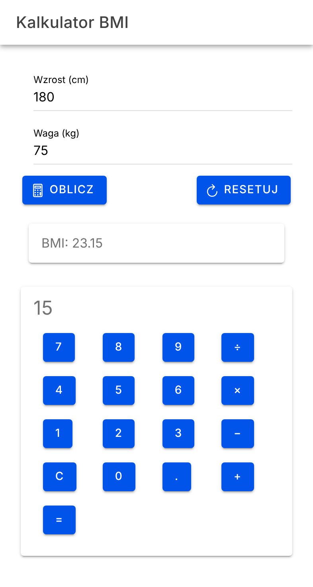

# Lab 04 
Aplikacja zbudowana w Ionic z biblioteką React. Zawiera kalkulator BMI (zadania 1 i 2) oraz prosty kalkulator z czterema działaniami, zrobiony jako osobny komponent `Kalkulator` (zadanie 3).

## Uruchomienie

Wymagane są Node.js oraz Ionic CLI .
Aplikacja otworzy się w przeglądarce pod adresem http://localhost:8100. Podgląd jak na telefonie: F12, a potem ikona Toggle device toolbar (Ctrl+Shift+M).

## Co zostało zrobione

- **Zad. 1 i 2 – kalkulator BMI:** dwa pola (wzrost w cm i waga w kg) w siatce `IonGrid`, przyciski „Oblicz” i „Resetuj” z ikonami. Wartości z pól odczytywane są przez `useRef`, a wynik trzymany w stanie (`useState`) i pokazywany w karcie z zaokrągleniem do dwóch miejsc po przecinku. Karta pojawia się dopiero po obliczeniu, a „Resetuj” czyści pola i ukrywa wynik.
- **Zad. 3 – kalkulator:** komponent w `src/components/Kalkulator.tsx`, wstawiony w `App.tsx` pod kalkulatorem BMI. Wyświetlacz, poprzednia liczba i wybrane działanie są w stanie. Przyciski leżą w siatce o czterech kolumnach. Wynik można wykorzystać w kolejnym działaniu, przycisk `C` czyści wszystko, druga kropka w liczbie jest ignorowana, a dzielenie przez zero pokazuje napis „Nie można dzielić przez zero”. Działania liczone są instrukcją `switch`, bez `eval()`.

## Zrzut ekranu (widok telefonu)

Cała strona: kalkulator BMI z wynikiem dla 180 cm i 75 kg oraz kalkulator z zadania 3 po działaniach `9 − 4 =`, a potem `x 3 =` (wynik 15):

