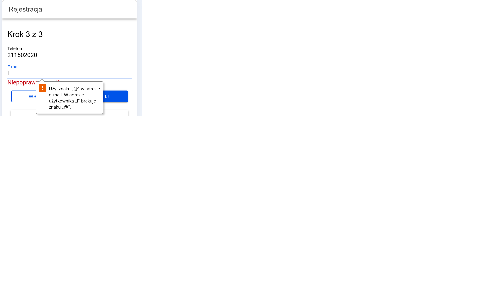
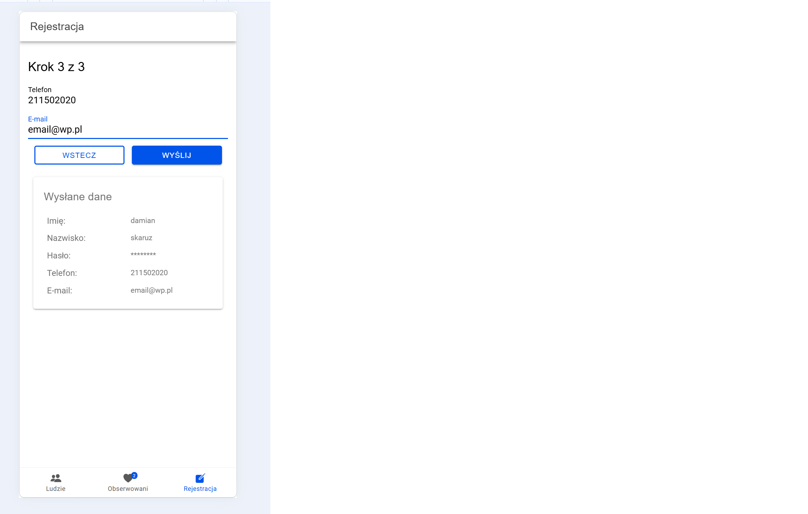

# Lab 06 – Aplikacja Ionic

## Uruchomienie aplikacji

Aby uruchomić aplikację, należy wykonać podane polecenie w terminalu, gdy jestesmy w katalogu projektu:

```bash
ionic serve
```
Jesli node nie dziala to trzeba zainstalowac z https://nodejs.org/en/download/, a IONIC CLI poleceniem

```bash
npm install -g @ionic/cli
```

Aplikacja uruchomi się lokalnie w przeglądarce.

## Zrzuty ekranu

### 1. Błąd


### 2. Lista osób


### 3. Obserwowani


### 4. Szczegóły


### 5. Wysłane
